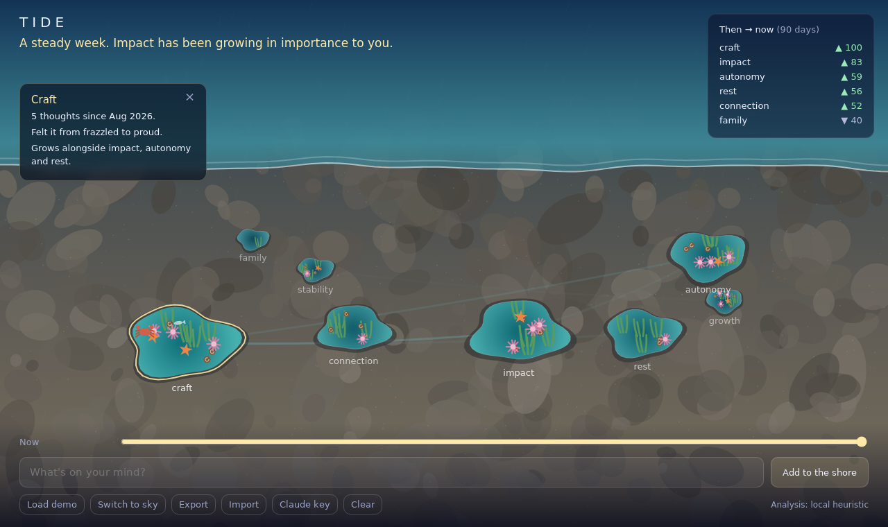
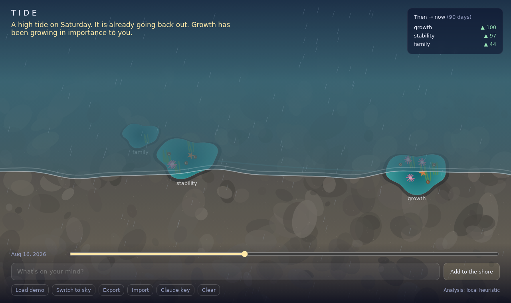

# Tide

A thought journal where **what you value is a tide pool (it grows and fills with life)** and **how you feel is the tide (it always goes back out)**.

- Write a thought. It is read for the values behind it and the emotion in it.
- Each value is a tide pool. The more it matters to you right now, the bigger the pool.
- The life inside a pool shows its **nuance**: how richly you have explored that value. One mention is a bit of seaweed. A value you have thought about many times, on good days and hard ones, connected to other values over months, fills with anemones, starfish, crabs and fish.
- Emotion is the tide. Hard days bring the water in over the pools; good days are a calm, sunlit low tide. Feelings fade with a 2-day half-life, so the tide always recedes, and the pools are still there.
- Tap a pool to read its story ("Craft: 5 thoughts since Aug. Felt it from frazzled to proud. Grows alongside impact, autonomy and rest.").
- Scrub the timeline to watch tides come and go while the pools slowly change. "Then → now" shows how your values moved over 90 days.
- There is also a night-sky view. Same data, different drawing; use "Switch to sky".
- Local-first: entries live in your browser. Optional Claude analysis uses your own API key, stored only in localStorage.

## How it works

Two separate measures per value, both computed from your entries at any point in time:

| Measure | What it captures | How |
|---|---|---|
| Importance (pool size) | How much a value matters lately | Each mention counts, fading with a 30-day half-life |
| Nuance (life in the pool) | How deeply you've explored it | Number of thoughts, emotional range, links to other values, time span. It accumulates and does not fade |

Emotion is a third, fast signal: intensity fading with a 2-day half-life.

## Run

    python3 -m http.server 8080   # then open http://localhost:8080
    node model.test.mjs     # model tests (node 18+)

## Code

`model.js` is pure logic (decay, nuance, stories, weekly note) and is tested. `pools.js` and `sky.js` are interchangeable renderers over the same data. `analyze.js` calls Claude with a local fallback.
